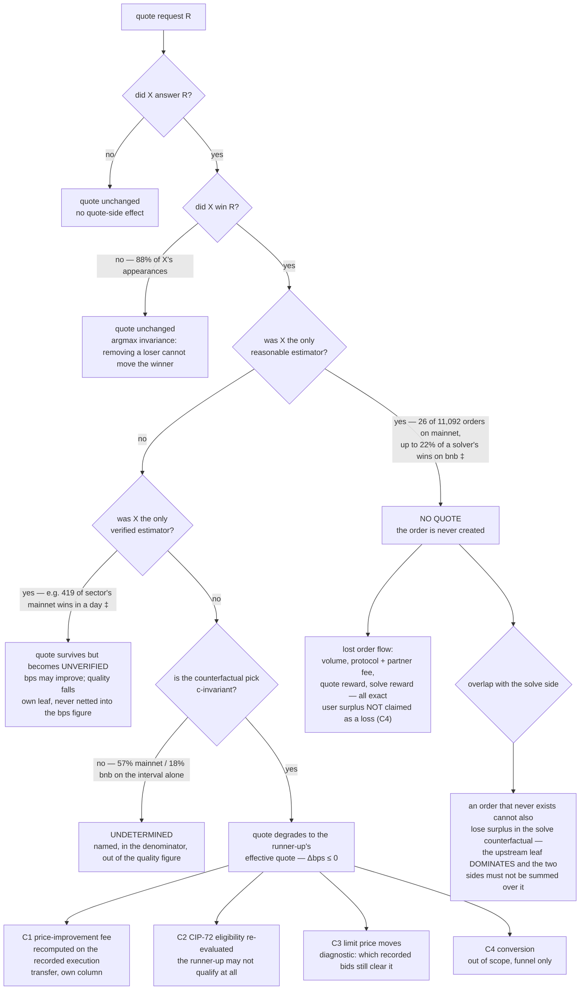

# Proposal — extending the leave-one-out analysis to the quote competition

**Status: implemented**, as [M15](PLAN.md#16-m15--the-quote-competition--done). This
document is kept as the evidence and the argument behind that decision; where it says
"proposed" or "would", read it as the case that was made. Three things the implementation
did differently, all three because the review found the document overcomplicating them:

- **There is no quote-side fee channel.** §3's C1 treated the price-improvement fee as a
  new computation to build. It is not: the fee's reference *is* the effective amount of the
  best quote, and `fees.py` has computed exactly that since M13. The counterfactual is the
  same validated function with a different `Quote`, and its result goes **into**
  `delta_protocol_fees` rather than into a column beside it (D28). §2's "two netting
  conventions, and they are not interchangeable" is therefore wrong as a warning about
  fees — one netting is the *ranking* currency and the other is the accounting model's
  volume-factor netting, which belongs to reward eligibility. The fee has exactly one
  reference and it was already implemented.
- **The hidden scalar is not the crux.** §2 concludes that `c` must be reconstructed and
  that 57% of mainnet counterfactuals are otherwise undetermined. Both true, and both
  beside the point: ranking on the effective amount netted in the **sell** token needs
  only `order_quotes.gas_price` and `sell_token_price`, which are recorded per order, and
  it reproduces the recorded winner on **99.6%** of mainnet and **100.0%** of bnb
  order-creating requests. There is no scalar to bound and no undetermined set. The
  autopilot's own out-token rule is kept as `--quote-ranking autopilot`, the cross-check
  (D27).
- **The ledger is three figures, not eleven.** §6's table is the full inventory; what
  ships leads with how much worse the quotes get, how often there is no quote at all, and
  the fee — which is not a third column but the existing one.

Supersedes an earlier draft of the same name (branch
`claude/solver-value-quote-analysis-ad225a`, worktree `codebase-review-prep-38fe5c`). The
earlier draft's framing of the five value channels survives; its central claim — "the quote
competition needs one line to replicate, `argmax` over the remaining effective quotes" —
**does not**, and §2 is the measurement that kills it. Everything below was measured while
writing it; each number carries its window.

**If you want the concrete version first, read [§12](#12-worked-example--one-order-end-to-end)** —
one real order from ladder to fee delta, with every number checked against the record.

The existing pipeline values a solver by removing it from the **solve** competition. This
adds the **quote** competition: remove an estimator, re-run the pick, and measure how much
worse the quote gets and how often no quote exists at all — then place that beside the
solve-side surplus, fee, reward and coverage deltas as one ledger.

---

## 1. Two universes, and the reason they must stay apart

The quote side has two natural populations, and almost every design mistake available here
comes from mixing them.

| | **request universe** | **order universe** |
| --- | --- | --- |
| what it is | every prod quote request | the requests that became an order |
| size | 1.22 M/day mainnet, 1.09 M/day bnb, `fast` excluded (2026-08-25) | ~1.6 k/day mainnet (11,092 in the 2026-08-10..16 week) |
| source | ClickHouse `gold_quotes` alone | ClickHouse **joined to** the analytics DB by a fuzzy match |
| answers | *would a quote have existed?* *who would have won?* | *what did the worse quote cost, in money* |
| exactness | exact — no join, no price feed | limited by the match (§5) and by two price feeds |
| money | none | fees, rewards, limit prices, the solve-side join |

So the deliverable is **not** one number per solver. It is an availability answer computed
over all quote traffic, a quality answer computed over matched orders, and a money answer
computed over matched *executed* orders — three denominators, each labelled, exactly as
D24 already does on the solve side.

---

## 2. How the quote winner is actually picked

The earlier draft assumed the quote competition is `argmax out_amount`. It is not, and the
gap is not small: on **mainnet, 2026-08-25, prod**, the recorded winner is the highest
gross `out_amount` in only

| `price_quality` | winners | winner is gross rank 1 | share |
| --- | --- | --- | --- |
| `optimal` | 1,172,704 | 605,455 | **51.6%** |
| `verified` | 33,620 | 9,094 | **27.0%** |
| `fast` | 201,528 | 184,999 | 91.8% |

of requests. The rule is in
`services/crates/price-estimation/src/competition/quote.rs`:

```
compare_quote_result   (:203)  verified beats unverified, when the mode prefers verified
                               Ok beats Err; Err vs Err by recoverability
compare_quote          (:226)  otherwise rank on effective_eth_out
effective_eth_out      (:276)  eth_out = out_amount × native_price(out_token)
                               fees    = gas × gas_price
                               sell:  eth_out − fees   → maximise
                               buy:   eth_out + fees   → minimise
is_reasonable          (:191)  drop any estimate with gas == 0 or out_amount == 0
```

with `native_price` the api's native-price estimate of the **out** token (buy token for a
sell order, sell token for a buy order) and `gas_price` the gas oracle's effective price at
quote time. `PriceRanking::BestBangForBuck` is what the prod `optimal` estimator is built
with (`factory.rs:381-392`), and the `optimal` path is **one stage with no
early return** — every estimator is asked, so removing one does not change who else was
consulted. (The `fast` path *does* early-return, which is one more reason to exclude it;
the other is that `fast` requests carry no `quote_id` and never create an order.)

### The verified class is a hard first key, and prod uses it

The enum's code default is `Unverified` (`configs/src/price_estimation.rs`), so whether the
class rule applies at all is a deployment setting — and the data settles it. Over the
2026-08-10..16 order-creating requests there were **5,041 requests carrying both verified and
unverified estimates** (4,491 mainnet, 41.2%; 550 bnb, 8.6%), and a verified estimate won
**all 5,041**. Not one unverified estimate ever beat a verified one, at any amount.

Verification coverage itself differs wildly by chain: 2.9% of mainnet requests had no
verified estimate at all, against 75.7% on bnb. So the class-flip leaf of §4 — removing the
only verified estimator — is a mainnet phenomenon, and on bnb most requests never had the
option.

### The one scalar that decides everything

Neither `native_price` nor `gas_price` is recorded in ClickHouse. But they enter the
comparison only through the ratio

```
c = gas_price / native_price(out_token)        # out-token atoms per gas unit
rank on   s·out_amount − gas·c       s = +1 sell, −1 buy      → maximise
```

and `c` is **common to every estimator of one request**. So one unknown scalar per request
stands between the recorded ladder and a re-runnable pick. That is the whole difficulty of
the quote counterfactual, and it is tractable in two independent ways:

**Revealed preference.** For the recorded winner `w`, the set of `c ≥ 0` that makes `w`
optimal is an interval: each competitor `j` contributes `c·(gas_j − gas_w) ≥ u_j − u_w`.
Non-empty ⇒ the recorded winner is consistent with the rule. Measured on the order-creating
requests of the 2026-08-10..16 week:

| | mainnet | bnb |
| --- | --- | --- |
| requests with a recorded winner surviving `is_reasonable` | 10,906 | 6,397 |
| recorded winner in the verified-preferred class | **10,906 (100%)** | **6,397 (100%)** |
| — of those, requests where the class actually bound (mixed) | **4,491 (100%)** | **550 (100%)** |
| recorded winner rationalisable by some `c ≥ 0` | **10,905 (100.0%)** | **6,397 (100%)** |
| recorded winner = gross `argmax` (`c = 0`) | 8,377 (76.8%) | 5,966 (93.3%) |

Both structural rules hold on every request but one. That single mainnet exception is worth
naming rather than rounding away — it is the whole error budget of the pick model.

**Reconstruction.** `c` can be rebuilt from data: `order_quotes.gas_price` and
`order_quotes.sell_token_price` are recorded per order, which gives `c` **exactly** for buy
orders (out token = sell token); sell orders additionally need the native price of the buy
token, which the analytics DB carries in `auction_prices` / `int_backend_data__price_data`
(under D14's price-sanity discipline, and never the *corrected* feed — gotcha 12).

Reconstruction is not optional, because the interval alone is too wide to decide the
counterfactual. Measured (same week, contested wins, interval endpoints only):

| | mainnet | bnb |
| --- | --- | --- |
| quote wins analysed | 11,055 | 6,417 |
| counterfactual winner the same across the whole feasible interval | 4,729 (**43%**) | 5,238 (**82%**) |
| counterfactual winner depends on `c` | 6,326 | 1,179 |

The interval is wide by construction — finite on both sides for only 1,293 of 10.9 k
mainnet requests, median `[0.43, 39.4]`, a 91× range. So the design is: **reconstruct `c`,
validate it against the interval, and report the requests where the pick still depends on
`c` as undetermined** rather than picking a point inside the interval and calling it an
answer.

### Two netting conventions — and only one of them is about money

*Revised on implementation: the fee half of this section is wrong. The price-improvement
fee has one reference, the effective amount of the best quote, and `fees.py` computes it.
What follows is still a real distinction, but it is between the currency the **ranking**
compares in and the volume-factor netting the accounting model applies for **reward
eligibility** — not two candidate fee baselines.*

The protocol nets the gas cost out of a quote **twice, differently, for two different
purposes**:

| | **ranking** — who wins the quote | **accounting** — what the quote is worth |
| --- | --- | --- |
| source | `competition/quote.rs:276` | `int_backend_data__orders_with_winning_quotes` (`order_quotes_effective`) |
| gas valued in | the **out** token, at the api's native price | the **sell** token, at `order_quotes.sell_token_price` |
| volume factor | not applied | applied: `max(coalesce(volume_factor, 0))` over the order's policies |
| used for | the pick, and therefore every counterfactual pick | eligibility, reward matching, quality in bps |

Both must be ported, and each validated against *its own* recorded artefact: the ranking
against ClickHouse's `winner`, the accounting against the pipeline's own effective-quote
columns. Using either where the other belongs produces a plausible number that reconciles
with nothing.

---

## 3. What a worse quote costs — the channels

Unchanged from the earlier draft in substance; restated because the ledger in §6 needs it.

| | channel | quantity | exact? | who |
| --- | --- | --- | --- | --- |
| C1 | **price-improvement fee** — `min(factor × surplus_over_quote, cap × volume)` recomputed against the counterfactual quote on the *recorded* execution | a **transfer**: the user pays less, the protocol earns less, at unchanged execution | exact — and **already built** | user ↔ protocol |
| C2 | **quote rewards** (CIP-72) — would the counterfactual winner have been eligible at all | protocol outlay | exact | protocol → solver |
| C3 | **limit price / fillability** — a better quote makes the order harder to fill | two-sided, real | diagnostic only | user |
| C4 | **conversion** — a worse quote means some users never place the order | probably the largest real effect | **not identifiable** | user |
| C5 | **availability** — no quote at all, or no *verified* quote | order flow that never exists | exact | everyone |

C1 needs no new fee code. `loo/fees.py` already reproduces the `priceimprovement` policy
wei-exactly — `_adjust_quote_to_order_limits`, `_price_improvement`, `quote_fee`, the
`f64` detour in `mul_f64` — against the recorded score for 19,653 of 19,653 solutions, and
`extract.py` already loads each order's `Quote` from `stg_backend_data__order_quotes`. The
counterfactual is: **substitute the `Quote` and call the same function.** That the fee path
was built for M13/M14 and lands the quote side for free is the single largest cost saving in
this proposal.

C4 stays out of scope and unproxied, as before: mainnet serves ~1.2 M requests/day against
~1.6 k order-creating ones, so the elasticity is both unknown and enormously levered. The
funnel is reported descriptively with no counterfactual claim attached.

---

## 4. The case tree

What actually happens to one request, and then to the order it may have created, when the
removed solver `X` is taken out. Leaf frequencies are mainnet 2026-08-10..16 matched orders
(11,092) and, where marked ‡, prod requests of 2026-08-25.



The solve side runs unchanged over the same window and contributes its own tree (bid or no
bid; sole unfiltered bidder; winner displaced; reference score moved). Crossing the two
gives the four cases the request asked about:

| | X sole quoter | X not sole quoter |
| --- | --- | --- |
| **X sole unfiltered solver** | order never created, and nothing else would have filled it either. Everything downstream is moot — surplus, fee, both rewards, coverage. Do not add the solve-side loss to the quote-side one. **18 of 11,092 mainnet orders, 1 of 6,491 on bnb** | order created at a worse quote, then **not filled**: solve-side coverage loss, and the order's limit was worse than the record — the one case where C3 is not a footnote. **820 of 11,092 mainnet orders, 542 of 6,491 on bnb** |
| **X not sole solver** | order never created; the solve competition would have filled it if it had existed. The loss is order flow, not price. **8 of 11,092 mainnet orders, 59 of 6,491 on bnb** — but per solver on bnb it is large: `baseline` won 3,295 of its 15,216 requests as sole estimator, `wraxyn` 4,590 of 28,828 ‡ | the ordinary case: Δquote bps upstream, Δsurplus / Δfee / Δreward downstream, all four reported side by side. **~92% of mainnet orders** |

Marginals for the same window: 26 mainnet orders had a single quoter, 838 a single unfiltered
solve bidder, and 157 no unfiltered solve bidder at all.

Three reads worth carrying into the write-up:

- **Thin is thin on both sides.** 18 of the 26 mainnet sole-quoter orders were *also*
  sole-solver orders — 69%. The two coverage risks are not independent, which is exactly why
  the overlap has to be counted rather than assumed away in either direction.
- **On mainnet the coverage story is downstream, not upstream.** The solve-side sole-bidder
  leaf is 32× more frequent than the quote-side sole-estimator leaf (838 vs 26 orders).
  "We would not find a quote" is a bnb answer, not a mainnet one.
- **The quote winner often does not bid on its own order.** Over the mainnet week,
  `tsolver` won 873 order-creating quotes and was absent from the solve competition on 450
  of them (52%); `dFusion` won 48 and bid on none. So the quote-side and solve-side value of
  one solver are genuinely different quantities for the same solver — which is the reason
  the combined view is worth building at all.

---

## 5. The join, and how much of it is trustworthy

There is still **no `quote_id` on an order**: `order_quotes` (and its staging model) carry
amounts, gas and solver but no id, and `public.quotes` — which does have `id` — is a stale
5,522-row snapshot from 2026-02-04. The match therefore stays a heuristic. What is new is
that it can be **corroborated exactly**, and tiered accordingly.

The winning estimate's `out_amount` in ClickHouse should be the amount stored on the order.
Measured over the matched orders of 2026-08-10..16:

Both sides are compared as `float64`: ClickHouse stores amounts as `Float64`, so "exact"
below means equal to the last float bit, not equal to the atom. For a matching key that is
enough — two independent amounts agreeing to 1e-16 relative do not happen by accident — but
it is not the atom-level identity the solve side is used to.

| agreement between the winning estimate's `out_amount` and `order_quotes` | mainnet | bnb |
| --- | --- | --- |
| bit-exact | **8,644 / 11,092 (77.9%)** | **5,082 / 6,491 (78.3%)** |
| within 1e-9 relative | 8,680 (78.3%) | 5,120 (78.9%) |
| within 1e-4 relative | 9,537 (86.0%) | 5,488 (84.6%) |
| median / p90 relative gap | 0 / 2.7 bps | 0 / 3.4 bps |

So roughly four in five matches are confirmed by an identity the matcher never used. That
gives a tiering the earlier draft could not offer:

- **Tier A — corroborated.** Tokens, kind, amount and time match *and* the winner's
  `out_amount` reproduces the order's stored quote exactly. This is the trusted core.
- **Tier B — heuristic only.** quote-redesign's rule (winner-consistent, ≤30 min before
  creation to ≤90 s after, 0.5% tolerance on buy amounts) without the identity. Mostly
  orders created from a later re-quote.
- **Unmatched.** Reported, never imputed. ~25% of orders, largely genuine limit orders
  placed hours after any quote.

Discipline: every headline is computed on Tier A **and** on Tier A ∪ B. If the two disagree
beyond a stated tolerance, the tail is the finding and the number is not published. A match
failure can then only degrade the *counterfactual*; the baseline — the actual quote, its
fee, its reward — always comes from Postgres and never from the match (the earlier draft's
Q-D3, which survives intact and is the reason this is a tractable dependency).

---

## 6. The combined ledger

*Revised on implementation: what ships is the three-figure version below the table — how
much worse the quotes, how often no quote at all, and the fee, which lives inside the
existing `delta_protocol_fees` rather than beside it. This table remains the full
inventory of what the run computes and the report file carries.*

One window, one removal scenario, one table. Every row names its denominator; nothing is
summed across rows.

| | figure | universe | sign | status |
| --- | --- | --- | --- | --- |
| quote availability | requests where X was the sole reasonable estimator; sole *verified* estimator | all prod requests | count | new |
| lost order flow | orders that would not exist: count, volume, protocol + partner fee, quote reward, solve reward | matched orders | ≤ 0 | new |
| quote quality | Δeffective quote, bps, volume-weighted over contested wins, outlier-disciplined | Tier A orders | ≤ 0 | new |
| verified-class flips | wins where the quote survives but stops being verified | matched orders | count | new |
| C1 transfer | Δprice-improvement fee at unchanged execution | executed matched orders | signed | new, reuses `fees.py` |
| C2 quote rewards | Δ CIP-72 payout | matched orders | signed | new |
| Δuser surplus | M2 | analysed auctions | signed | built |
| Δprotocol / partner fee | M13 | analysed auctions | signed | built |
| Δrewards | M3 | analysed auctions | signed | built |
| coverage | M10/D24 only-with executions | analysed auctions | count | built |
| overlap | orders in both the "never created" and a solve-side leaf | matched orders | count | new |

**What leads, of that inventory.** Three figures, one per question the quote side exists to
answer, mirroring the four the solve side leads with:

| | figure | mirrors |
| --- | --- | --- |
| how much worse the quotes | one bps number over the window's whole quoted volume, with the conditional reading beneath it | the solve side's relative price change (D20/D23) |
| how often no quote at all | a count and its share of every order the quote window created | the coverage count (D24) |
| what it costs | **nothing new** — the price-improvement fee delta is inside `delta_protocol_fees` (D28) | the fee delta itself (M13) |

Everything else — quote wins, class flips, match tiers, per-leaf counts, the `_all`
companions — is detail in the report file and in `compare`, not a headline. The single
figure that legitimately *combines* the two sides is orders lost, deduped across the
"never created" and "no longer executed" leaves: same unit, same population. Price and
money do not combine — a quote bps is a change in the limit the user was shown, a solve bps
a change in what they received, and the fee delta a transfer.

Sign convention inherited unchanged: **counterfactual − actual** (D16), stamped into the
report JSON, so the quote columns read the same way as every existing one.

The one genuinely new discipline: **the quote side is upstream of the solve side**, so their
deltas overlap. An order that is never created cannot also lose surplus in the solve
counterfactual. The proposal is to report both sides side by side with the overlap counted
and named, *not* to re-run the solve counterfactual on a reduced order set — because
deleting an order also removes it from every other solver's opportunity set in that auction,
and what those solvers would have done instead is not recorded. At order level the overlap is
small on both chains — 26 of 11,092 mainnet orders, 60 of 6,491 on bnb — so machinery beyond
a count would be bought for nothing. Where it carries weight is per solver on bnb: `baseline`
won 21.7% of its requests as the sole estimator, and for such a solver the "no quote at all"
row is the headline and the surplus row is a rounding error.

---

## 7. Correctness — the gate ladder

This is where most of the work is. Each gate is a check against a **recorded artefact**, in
the M1 tradition: reproduce what happened before believing anything about what did not. G1,
G2 and G7 already hold, G6 held in the prior art; the rest are the milestones' acceptance
criteria.

| | gate | against | measured | verdict on failure |
| --- | --- | --- | --- | --- |
| G0 | support: chains and window from `min(event_timestamp)` per chain, never assumed | ClickHouse | prod: 2026-07-22 15:28 → now, mainnet + bnb only, 113.7 M prod requests | refuse the run; quote columns *unavailable*, not empty |
| G1 | the recorded winner is in the verified-preferred class | ClickHouse `winner` | **17,303 / 17,303**, of which **5,041 / 5,041** mixed requests where the rule bound (both chains, 2026-08-10..16) | model wrong — stop |
| G2 | the recorded winner is rationalisable by bang-for-buck for some `c ≥ 0` | ClickHouse ladder | **17,302 / 17,303** | model wrong — stop |
| G3 | reconstructed `ĉ` lies inside the request's feasible interval | G2's interval | to measure | exclude and name the request |
| G4 | with `ĉ`, our `argmax` **is** the recorded winner | ClickHouse `winner` | to measure — the quote-side M1 gate, runnable on 1.2 M requests/day | `bug` if no fallback was involved |
| G5 | our effective quote for the winner reproduces the pipeline's own columns | `int_backend_data__orders_with_winning_quotes`, `fct_data_per_trade` | port, expect exact | port is wrong |
| G6 | our CIP-72 eligibility reproduces `is_eligible_for_quote_reward` | the pipeline flag | quote-redesign: 100% | port is wrong |
| G7 | recomputing the price-improvement fee with the **recorded** quote returns the recorded fee | `proposed_solutions.score` | 19,653 / 19,653 (`fees.py`) | regression |
| G8 | Tier A and Tier A ∪ B agree; unmatched share reported | §5 | 78% corroborated | publish neither number, publish the split |
| G9 | outlier discipline on the counterfactual ladder, D14-style | — | needed: a bnb prototype showed a −395 bps *median* for one solver, which is junk, not a market | exclude and name |
| G10 | invariants, as unit tests | — | — | bug |

The invariants under G10 are cheap and catch most of what the gates cannot:

1. **Removing a solver that never quoted returns exactly zero** on every quote column — the
   quote-side analogue of the existing null test.
2. **Removing a loser never moves the winner**, and never changes the winner's class — a
   removed unverified estimate cannot make a verified winner unverified, and vice versa.
   Follows from the rule; assert it anyway, since it is what makes 88% of appearances a
   no-op and therefore what makes the whole thing cheap.
3. **When the counterfactual winner is in the same class as the actual one, Δquote ≤ 0.** A
   positive delta is a bug. The one exception is the class flip — removing the only verified
   estimator can *raise* the nominal amount while lowering the quality — which is a separate
   leaf precisely so this invariant stays assertable everywhere else.
4. **`c` monotonicity**: the counterfactual winner as a function of `c` is piecewise
   constant with at most one change per competitor pair; the interval search must agree with
   a brute-force scan on random ladders.
5. **Determinism**: same window, same scenario, same report — the `_live` ClickHouse views
   are excluded for this reason alone (they splice in the last ≤6 h from raw tables).
6. **The estimator → address map is consistent across tiers.** quote-redesign derives it
   from unambiguous matches, so checking it against the same matches is circular. Deriving
   it independently from Tier A and from Tier B and requiring agreement is not.

Two failure modes deserve naming ahead of time, because both are things the earlier draft
would have shipped:

- **A gross-ladder quality figure.** `price_rank`, `behind_best_bps` and `behind_winner_bps`
  in `fct_quote_estimates` are computed on `out_amount` alone. They are not "how far behind
  the winner this solver was" in any sense the protocol uses — G2 shows the pick disagrees
  with the gross rank on 23% of mainnet order-creating requests, and the day-level figure is
  48%. Those columns are usable as diagnostics and unusable as deltas.
- **A per-request median gap.** Medianing bps over raw requests compares a solver with
  300 k tiny UI polls against one with 60 k, on incomparable bases. Quality figures are
  volume-weighted over matched orders, as on the solve side.

---

## 8. Proposed decisions

In PLAN.md's `D` style, to be renumbered on merge. Q-D1 replaces the earlier draft's; the
rest are carried forward or new.

| | decision | chosen over |
| --- | --- | --- |
| Q-D1 | The counterfactual pick reproduces the **protocol's own rule** — verified class first, then `s·out_amount − gas·c` — with `c` reconstructed from gas and native prices and **validated against the request's revealed-preference interval** | `argmax out_amount` (the earlier draft) — explains 51.6% of mainnet picks on a day and 76.8% on order-creating requests; a plain gap metric built on it would be wrong about who wins in a quarter of cases |
| Q-D2 | A request whose counterfactual pick changes across the feasible `c` interval is **undetermined**: named, counted, kept in the denominator, excluded from the quality figures | picking a point in the interval — 43% mainnet invariance says the interval decides little on its own, so a point estimate would be a guess dressed as a measurement |
| Q-D3 | The **ranking** netting and the accounting model's **volume-factor** netting are separate functions, each validated against its own recorded artefact. *Revised:* the price-improvement fee is not a third one — its reference is the effective amount `fees.py` already computes (D28) | one undifferentiated "effective quote"; and, in the first draft, treating the fee as needing its own baseline |
| Q-D4 | Effective amounts port the dbt `order_quotes_effective` CTE **exactly**; surplus and price-improvement fees are never applied to a quote | an independent netting formula |
| Q-D5 | The **baseline** quote, its fee and its reward come from Postgres; ClickHouse supplies **only** the counterfactual ladder | deriving both from the matched request — makes the headline hostage to a 78% identity |
| Q-D6 | Matches are **tiered** (A corroborated / B heuristic / unmatched) and every headline is computed on both A and A ∪ B | one match rate and one number |
| Q-D7 | C1 is reported as a **user ↔ protocol transfer** in its own column and **never summed** into solve-side Δsurplus | one "total value" figure |
| Q-D8 | Conversion (C4) is **out of scope and unproxied**; the funnel is descriptive | an elasticity proxy at a 0.13% conversion rate |
| Q-D9 | An order in the "never created" leaf is **not** also charged for its solve-side delta; the overlap is counted and named, and the solve counterfactual is *not* re-run on a reduced order set | summing the two sides — double counting; re-arbitrating without the order — its removal changes every other solver's opportunity set, which is not recorded |
| Q-D10 | Quote-side runs are restricted to **mainnet and bnb from 2026-07-22**; other networks report quote columns as *unavailable* | silently empty columns, which read as "no value" rather than "no data" |
| Q-D11 | The estimator → solver-address map is derived **empirically per chain**; a solver's identity in the combined report is a **set of solve addresses ∪ estimator names**, resolved exactly (D9's rule) | a static map, or assuming names line up — quote-redesign found bnb resolves differently, and `dfusion` won 48 mainnet quotes in the 2026-08-10..16 week while bidding in the solve competition on none of them |
| Q-D12 | `fast` requests are excluded (no `quote_id`, early-return stages, indicative prices); `_live` views are excluded (non-deterministic) | including them for volume |
| Q-D13 | Sign convention inherited unchanged: **counterfactual − actual** (D16), stamped into the report JSON | a quote-side convention |

---

## 9. Shape

A parallel package, not a modification of `loo/`:

```
loo/
  ch.py               # ClickHouse over HTTP, mirroring db.py's shape (urllib, no new dep)
  quotes/
    ladder.py         # request universe: per-request ladders, aggregated in ClickHouse
    pick.py           # pure: the ranking rule, the c interval, the LOO pick
    effective.py      # the accounting CTE, exactly; eligibility (CIP-72)
    match.py          # tiered order <-> request matching (port from quote-redesign)
    counterfactual.py # per-request and per-order diffs, outlier discipline
    aggregate.py      # window report; same sign convention and format discipline
```

Kept separate because the quote side has a different support matrix (two chains, 40 days), a
second credential and a second database technology; folding it into `extract.py` would make
every existing xdai run carry a dependency it cannot satisfy. `run.analyse_window` gains an
optional quote pass and `compare` gains quote columns.

`pick.py` takes plain dataclasses and no client, like `winner_selection.py`:

```python
@dataclass(frozen=True)
class Estimate:
    estimator: str
    solver: str | None      # resolved per chain, None if it has no solve-side counterpart
    out_amount: float       # Float64 in ClickHouse — see below
    gas: float
    verified: bool
```

**This is the one place the repo's integer discipline cannot hold.** `out_amount`, `in_amount`
and `gas` are `Float64` in `gold_quotes`, so the ladder arrives with ~15–16 significant
digits and an 18-decimal amount above ~0.01 tokens is already past `2^53`. Everything
computed *from the ladder* — the pick, the interval, Δbps — is therefore float, and the
quote-side report should say so rather than inherit an exactness claim it cannot meet. The
`fees.py` path stays integer-exact because it runs on the Postgres quote, not the ladder
(Q-D5 again), and that is where the money numbers come from. ClickHouse's JSON also returns
large `Float64` values as integer-looking strings — coerce explicitly, as quote-redesign
learned to.

Credentials are already in `.env` (`CLICKHOUSE_URL`, `CLICKHOUSE_USER`,
`CLICKHOUSE_PASSWORD`) — note the worktrees do not carry `.env`.

### Cost, and where it hides

Not in the arbitration this time. The two tables hold **135.2 M requests and 632.8 M
estimates (46.7 GiB)** for the 40 days of both chains and both environments, and a 40-day
mainnet window alone is ~49 M requests. So the request-universe pass **must aggregate inside
ClickHouse** and return per-estimator summaries, never rows: the per-estimator day aggregate
behind §4 returned in seconds. Two shapes to respect:

- `fct_quote_estimates` is sorted `(chain_id, environment, estimator, event_timestamp,
  request_id)`, so `estimator = …` is a key prefix and `request_id IN (…)` is not — per-solver
  sweeps are cheap, per-request lookups scan the day's partitions.
- Partitioning is `(chain_id, environment, toYYYYMMDD(event_timestamp))`, so day-bounded
  filters prune. Every query carries `settings max_execution_time`, in the spirit of
  CLAUDE.md's bound-every-query rule.

The order universe is trivial by comparison — ~11 k requests a week, ladders and all.

---

## 10. Milestones

**Q0 — record the feasibility measurements** (this document) in `docs/quotes.md`: coverage,
the pick rule with its source map, the two netting conventions, G1/G2's numbers, the
corroboration identity, the ClickHouse key shapes. Durable context, per CLAUDE.md's split.

**Q1 — the pick, validated.** `ch.py`, `ladder.py`, `pick.py`: the ranking rule, the
revealed-preference interval, the LOO pick. **Gate:** G1 and G2 at scale on a full window —
this document measured them on 17 k order-creating requests, and they must hold on the 49 M
of the request universe too, where the population is UI polling rather than real orders.

**Q2 — `c` reconstruction.** Gas and native prices from Postgres, G3, then **G4 — the
quote-side M1 gate**: with `ĉ`, does our `argmax` return the recorded winner? Reported as a
rate with the undetermined set counted separately, M1-style. Nothing downstream is worth
building if G4 comes back poor, so this is the milestone that decides the project.

**Q3 — availability.** C5 over the request universe: sole-estimator and sole-verified rates,
per solver, both denominators. This is the first publishable answer and it needs no match.

**Q4 — matching, tiered.** `match.py`, G8. Ports quote-redesign's heuristic and adds the
corroboration identity.

**Q5 — effective quotes and quality.** `effective.py`, G5, then Δbps volume-weighted with
G9's outlier discipline, plus the class-flip leaf.

**Q6 — C1.** Substitute the `Quote` in the existing `fees.py` path; G7 as a regression.
Report as a transfer.

**Q7 — C2.** Counterfactual CIP-72 eligibility and payout; G6.

**Q8 — the combined ledger.** §6, with the case-tree counts of §4 in the report and the
overlap named. The actual deliverable; Q1–Q7 are how it becomes trustworthy.

**Q9 — C3 diagnostic** (optional). Which recorded bids still clear the counterfactual limit.

---

## 11. Open questions

1. **Which window, and does bnb get a solve side?** The quote data starts 2026-07-22, so a
   combined run is capped at 2026-07-22..2026-08-31 (40 days). bnb is where the quote
   competition is thin enough for C5 to dominate — and where the interesting answer probably
   is — but no solve-side loo run exists for it yet. `db.py` already knows the network, so
   the cost is a run, not a feature.
2. **Is `c` worth reconstructing per request, or per (chain, minute)?** Gas price and native
   prices move slowly; a per-minute `c` would be far cheaper and its error is measurable
   against the per-request interval. Worth measuring in Q2 before building the per-request
   path.
3. **Does the volume cap bind on C1?** `min(factor × improvement, cap × volume)` — if the
   ~1% cap usually binds, C1 mostly evaporates and Q6 is not worth building. Still open, and
   cheap to settle with `fees.py` on a recorded window.
4. **`kipseli`.** It won 301,465 mainnet requests on 2026-08-25 — more than anyone — and its
   prototype median degradation is −0.58 bps, the smallest of any major quoter. Is that a
   well-calibrated pool where the marginal quoter adds nothing, or an artefact? It changes
   what the whole analysis is expected to show, and it is answerable in Q1.

---

## 12. Worked example — one order, end to end

Everything above in one real order. Mainnet, 2026-08-12, order
`0x67430cc00d4453ce…`, a **sell** order for 0.008367392900135118 WETH (8,367,392,900,135,118
wei) into USDC. Quote-time context recorded on `order_quotes`: `gas_price = 193,118,252`
wei/gas, `sell_token_price = 1.0` (WETH is mainnet's native reference), and the order's fee
policies give `volume_factor = 0.0002`.

### Step 1 — the ladder, as ClickHouse recorded it

`c = gas_price / sell_token_price = 193,118,252` sell-token atoms per gas unit, so each
estimator's own `gas` becomes a cost in WETH, and the effective quote is that cost taken off
the input before converting at the estimator's rate:

```
eff_buy = (in_amount − gas × c) / in_amount × out_amount
```

| estimator | `out_amount` (USDC atoms) | `gas` | verified | gas cost (WETH) | **effective quote** |
| --- | --- | --- | --- | --- | --- |
| **fractal** | **16,023,769** | **219,655** | yes | 0.000042419 | **15,942,535** ← winner |
| baseline | 16,014,326 | 239,146 | yes | 0.000046183 | 15,925,936 |
| tsolver | 16,013,699 | 275,065 | yes | 0.000053120 | 15,912,037 |
| balancer-quote | 16,013,358 | 329,595 | yes | 0.000063651 | 15,891,544 |
| bitget-quote-native | 16,012,545 | 397,717 | yes | 0.000076806 | 15,865,562 |
| barter | 16,011,911 | 500,000 | **no** | 0.000096559 | 15,827,135 |
| wraxyn-quote-native | 15,998,311 | 258,021 | yes | 0.000049829 | 15,903,040 |
| brrr | 15,193,410 | 354,734 | yes | 0.000068506 | 15,069,018 |

`fractal` wins on both dimensions here — best amount *and* least gas — so its feasible `c`
interval is the whole half-line `[0, ∞)` and the pick needs no price at all. That is the easy
case; §2's undetermined set is the other one.

### Step 2 — remove `fractal`, re-run the pick

`baseline` is next, on any `c`: 15,925,936 against 15,942,535, so the quote the user would
have been shown is worse by

```
16,599 atoms  =  −10.41 bps
```

This is the **quality** number, and it is all this order contributes to it — weighted by its
16 USDC of volume when the window figure is formed.

### Step 3 — what the recorded execution says

The order settled at block 25,721,044: the user received **15,970,750** USDC atoms, and the
fee rows are `protocol / priceimprovement = 31,409` and `protocol / volume = 3,194`. So the
solution delivered **16,005,353** atoms gross, of which the protocol kept 34,603.

The check that makes the rest believable — recompute the recorded fee from the ladder:

```
0.5 × (16,005,353 − 15,942,535)  =  31,409.1   →  31,409 recorded
```

Atom-exact, with the factor 0.5 the policy carries, and note **which** effective quote the
fee uses: netted for gas only, *not* for the volume factor. Netting by `vf` as well puts the
baseline at 15,939,346 and the fee at 33,003 — 5.1% too high. That is §2's two conventions, on one order: `vf` belongs in the
reward-eligibility comparison and nowhere near the fee baseline.

### Step 4 — the fee under the counterfactual quote

The execution is held fixed; only the baseline moves:

```
counterfactual fee = min( 0.5 × (16,005,353 − 15,925,936),  0.0098 × 16,005,353 )
                   = min( 39,709, 156,852 )  =  39,709        (the cap does not bind)
Δ fee              = 39,709 − 31,409  =  +8,300 atoms  =  0.0083 USDC
```

The protocol earns 8,300 atoms more; the user receives 8,300 atoms less, **5.20 bps** of what
they actually got. And 8,300 is exactly half of the 16,599-atom quote degradation — the fee
factor is 0.5, so half of any quote degradation lands on the user and half was going to the
protocol either way. This is why the channel is a *transfer* and why it must not be added to
solve-side Δsurplus.

### Step 5 — what this order contributed

| counter | contribution |
| --- | --- |
| `fractal` quote wins | +1 |
| `fractal` contested wins (leaf: quote degrades) | +1 |
| quality, volume-weighted | −10.41 bps, weight 16 USDC |
| C1 transfer | +0.0083 USDC of protocol revenue, −0.0083 USDC to the user |
| C2 quote reward | unchanged here — `baseline` would also have qualified |
| availability | nothing: 8 estimators answered, 7 remain |

### The same order, if the winner had been picked differently

Two rows down the same window, order `0xfac4dde2d6de10cd…` (24.08 USDC → WETH) shows why the
pick is not "best price":

| estimator | `out_amount` (WETH atoms) | `gas` | verified | effective |
| --- | --- | --- | --- | --- |
| tsolver | **12,724,375,178,378,530** (best gross) | 980,000 | **no** | 12,523,… |
| **helixbox-quote-native** | 12,645,004,000,000,000 | **200,330** | yes | 12,602,… ← winner |

`tsolver` quoted 0.6% more and lost twice over: unverified, and 4.9× the gas. A gap metric
built on `out_amount` would record `tsolver` as the winner and `helixbox` as 63 bps behind.

### And the outlier that arrives on the first run

The prototype behind §4 put **77.99 ETH** of C1 transfer on one solver over the week. 77.974
of it came from a single order — 41.18 atoms of `0x050362ab…` into 8.1 XAUT — whose recorded
`sell_token_price` of 1,608 wei/atom values it at 66,240 ETH, four orders of magnitude wrong.
Excluded, the solver's figure is **0.012 ETH**. A factor of 6,500 from one price, on the first
run, on a channel that is otherwise atom-exact: G9 is a gate, not a nicety, and D14's
machinery already exists to enforce it.
